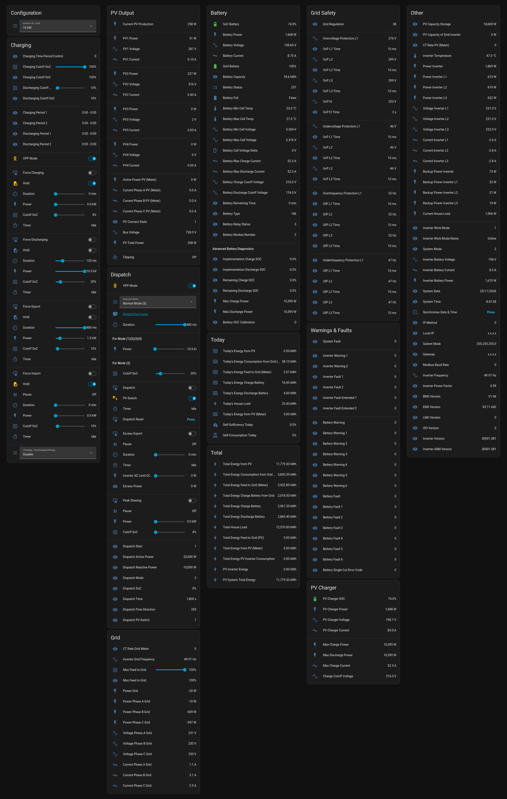

# 🔋 ha-alphaess-modbus: AlphaESS Modbus TCP Integration for Home Assistant

[](https://www.home-assistant.io)
[-orange?style=flat-square)](docs/)
[](LICENSE.md)

A comprehensive **Home Assistant** integration for **AlphaESS** inverter systems using **Modbus TCP**. Monitor and control your solar power system, battery storage, and grid interaction through an interactive dashboard with full automation support.

> [!WARNING]
> This integration **writes** to your inverter's Modbus registers. Incorrect writes can damage hardware, void manufacturer warranty, or breach local grid-tie regulations. Read [DISCLAIMER.md](./DISCLAIMER.md) before installing.

---

## 🚀 Overview

Everything runs locally over Modbus TCP - no cloud dependency. The integration covers monitoring, dispatch control, and dashboarding for the AlphaESS SMILE family.

### ✨ Key Features
*   **📊 Full monitoring:** PV strings, battery, grid (per-phase), energy statistics, firmware/system info, grid safety settings, and every warning/fault register.
*   **🎛️ Dispatch control:** force charge/discharge/export/import and excess-export helpers built on the inverter's dispatch register block, with power sliders, cutoff SoC, and durations.
*   **🛡️ Safety architecture:** mutual exclusion between force modes, dead-man's-switch dispatch durations, a full register reset on startup, connection loss, or timer expiry, and a VPP Mode that stops Home Assistant from writing the dispatch registers while an external controller is in charge.
*   **🖼️ Interactive dashboard:** complete Lovelace view plus ApexCharts power-flow diagrams (standard and extended).
*   **📚 Primary documentation included:** official AlphaESS datasheets, manuals, and Modbus protocol references in [`docs/`](docs/).

---

## 🖼️ Dashboard



---

## 🖥️ System Configuration

This integration was developed for and tested with:

| Component       | Specification                                         |
| --------------- | ----------------------------------------------------- |
| Inverter        | AlphaESS SMILE-G3-T10-INV (10 kW)                     |
| Battery         | 18.6 kWh (2x SMILE-G3-BAT-9.3S)                       |
| Back-up Box     | AlphaESS Back-up Box PLUS                             |
| Solar PV        | 2 strings wired to PV1 and PV2 inputs                 |
| Grid connection | 3-phase, 3x25A                                        |
| EV Charger      | AlphaESS EVCT11 wallbox (Not mapped via local Modbus) |
| Communication   | Modbus TCP (port 502)                                 |
| Home Assistant  | 2026.5+                                               |

---

## 🧩 Compatibility

The integration was developed against an AlphaESS SMILE-G3-T10 (see "System Configuration" above). The Modbus register layout is broadly shared across the SMILE family, so other models are likely to work with little or no modification.

**Confirmed working:**

- SMILE-G3-T10-INV (tested setup; see "System Configuration" above)
- SMILE5, SMILE-G3-S5, SMILE-Hi10, SMILE-B3, SMILE-B3-PLUS (tested by upstream contributors at [Projects @ Hillview Lodge](https://projects.hillviewlodge.ie/alphaess/))

**Reported compatible but not personally tested:**

- SMILE-Hi5
- SMILE-G3-S3.6 / B5 / S5
- SMILE-i3
- SMILE-T10-HV-INV

If you run a model not on this list, the integration may still work; please open an issue with your inverter model, firmware version, and any registers that report `unavailable` so the list can be updated.

**Known model-specific limitations:**

- Registers `0x072C-0x072F` (User Mode, Battery Mode, Set Battery Power, Set Inverter Output Power %) are HHE MEC only and are commented out by default.
- Registers `0x2200-0x2221` and `0x2250-0x225D` (AUX dry contacts and auto-start backup generator) are commented out unless your installation uses external physical switches or a backup generator.
- The SMILE-G3-T10 does not expose EV Charger data via local Modbus; the `0x2341` block is a DC-DC PV Charger, not an EV charger.
- **PV inputs:** the SMILE-G3-T4 / T5 / T6 / T8 / T10 family has **3 MPPTs (PV1, PV2, PV3)** and a separate dedicated battery port (BAT+/BAT-) - confirmed in the official datasheet ("MPPT Number / Max. Input Strings Number per MPPT: 3 / 1") and the IOM manual ("Positive and Negative PV Connectors, PV1/PV2/PV3"). The integration also reads registers `0x0428-0x042B` as `PV4` for compatibility with other AlphaESS models that expose a 4th channel; on the T-series these read zero. On some other AlphaESS hybrid models the 4th input may exist physically and may be configurable as either an extra PV string or a DC-coupled battery input via an inverter setting - consult your model's manual before relying on PV4.

---

## 📂 Repository Structure

| File                          | Purpose                                                                  |
| ----------------------------- | ------------------------------------------------------------------------ |
| `integration_alpha_ess.yaml`  | Core integration: Modbus sensors, template sensors, helpers, automations |
| `alphaess_view.yaml`          | Dashboard (Lovelace) configuration                                       |
| `power_diagram.yaml`          | ApexCharts power flow diagram                                            |
| `power_diagram_extended.yaml` | Extended power diagram with additional metrics                           |
| `docs/`                       | AlphaESS datasheets and Modbus protocol documentation                    |
| `screenshots/`                | Dashboard screenshots referenced from this README                        |
| [`CHANGELOG.md`](./CHANGELOG.md) | Release notes and change history                                       |
| [`LICENSE.md`](./LICENSE.md)  | BSD 3-Clause license text and upstream-attribution note                   |
| [`DISCLAIMER.md`](./DISCLAIMER.md) | Use-at-your-own-risk disclaimer (read before installing)             |

---

## ⚡ Installation

### 📋 Prerequisites

- Home Assistant with Modbus integration enabled
- Network access to your AlphaESS inverter via Modbus TCP
- [ApexCharts Card](https://github.com/RomRider/apexcharts-card) installed via HACS (for power diagrams)

### 🛠️ Setup

1. **Integration:** Copy `integration_alpha_ess.yaml` into your Home Assistant configuration as a package, or include it in `configuration.yaml`:

   ```yaml
   homeassistant:
     packages:
       alphaess: !include integration_alpha_ess.yaml
   ```

2. **Secrets:** Add the following to your Home Assistant `secrets.yaml`:

   ```yaml
   alphaess_modbus_host_ip: "<YOUR_INVERTER_IP>"
   alphaess_modbus_host_port: 502
   alphaess_modbus_slaveId: 85 # 0x55 - default for AlphaESS
   ```

3. **Dashboard:** Create a new dashboard in Home Assistant and paste the contents of `alphaess_view.yaml`.

4. **Power Diagrams:** Create panel views and paste the contents of `power_diagram.yaml` and `power_diagram_extended.yaml`.

5. **Restart** Home Assistant to load the integration.

---

## 🎛️ Modbus Dispatch Modes

The AlphaESS inverter is controlled via the Dispatch register block starting at `0x0880`. The dispatch system uses 11 consecutive registers to define a complete command.

### 🗺️ Register Map (0x0880 - 0x088A)

| Register | Offset | Parameter             | Description                                                                                         |
| -------- | ------ | --------------------- | --------------------------------------------------------------------------------------------------- |
| 0x0880   | Para 1 | Dispatch Start        | 0 = Stop, 1 = Start                                                                                 |
| 0x0881   | Para 2 | Active Power (High)   | High word of the 32-bit power value: always 0                                                       |
| 0x0882   | Para 2 | Active Power (Low)    | The power value itself: 32000 offset, below 32000 = charge, above = discharge (see below)           |
| 0x0883   | Para 3 | Reactive Power (High) | High word of the 32-bit reactive power value: always 0                                              |
| 0x0884   | Para 3 | Reactive Power (Low)  | Reactive power; the vendor guide says it can be 0, this integration writes 10000                    |
| 0x0885   | Para 4 | Dispatch Mode         | Operating mode (see table below)                                                                    |
| 0x0886   | Para 5 | SOC Target            | 0.4%/bit (SoC x 2.5, 250 = 100%); used by Mode 2 only. This integration writes 255 for 100%         |
| 0x0887   | Para 6 | Duration (High)       | Duration in seconds (high word)                                                                     |
| 0x0888   | Para 6 | Duration (Low)        | Duration in seconds (low word)                                                                      |
| 0x0889   | Para 7 | Flow Direction        | The vendor table lists 0-5 for test flows; this integration writes 255, as the original package did |
| 0x088A   | Para 8 | PV Switch             | 1 = PV on, 2 = PV off; 0 for systems without PV control (the force modes write 0)                   |

> **Start a dispatch with one write of the whole block.** This integration starts every dispatch with a single Modbus function-16 write of all 11 registers from `0x0880`. While a Home Assistant dispatch runs, moving one of its sliders rewrites only that parameter (power always as the `0x0881-0x0882` pair, so the high word stays 0). A value written to `0x0881` on its own lands in the **high** word of the power value and gives the inverter a huge number; the power belongs in `0x0882`. On a SMILE-B3, parameters written while the dispatch is stopped have been reported to be ignored, which a single block write avoids.
>
> **SoC scale:** the vendor documents 0.4%/bit, and a SMILE-G3-T10 was measured to stop at the 0.4%/bit target. A SMILE-B3 has been measured at 0.392%/bit (255 = 100%); B3 owners can change the `* 2.5` in the write templates and the sensor `scale` accordingly.

### ⚙️ Operating Modes

#### Standard Modes (Priority: House -> Battery -> Grid)

| Mode | Name                             | Para 2 (power) | Description                                                                                                                                      |
| ---- | -------------------------------- | -------------- | ------------------------------------------------------------------------------------------------------------------------------------------------ |
| 1    | Battery Only from PV             | Used           | Battery charges only from solar. No grid charging, no discharge.                                                                                 |
| 2    | SOC Control                      | Used           | Battery is controlled to the Para 2 power until the target SOC (Para 5) is reached, then stops.                                                  |
| 3    | Load Following                   | Used (limit)   | **Primary mode for automation.** Solar powers the house first, excess charges the battery. Accepts power limits (Para 2) and PV switch (Para 8). |
| 4    | Maximise Output                  | Ignored (0)    | Actively discharge battery to maximise AC power output to the grid.                                                                              |
| 5    | Normal Mode                      | Used (limit)   | Self-consumption like Mode 3, also with a battery power limit (Para 2).                                                                          |
| 6    | Optimise Consumption             | Ignored (0)    | Solar charges battery first. Grid supplements if needed.                                                                                         |
| 7    | Maximise Consumption             | Ignored (0)    | Battery charges from the grid at the maximum rate, whatever Para 2 says (solar still powers the house).                                          |
| 19   | No Battery Charge / Charge Limit | Ignored (0)    | Self-consumption with limited charging. The vendor text mentions a charge limit, but both vendor parameter tables give Para 2 = 0 for this mode. |

Per the vendor parameter tables, Para 2 must be 0 W (raw `32000`) for modes 4, 6, 7 and 19; this integration's Manual Dispatch sends the power slider only for modes 1, 2, 3 and 5.

Switching between dispatch modes can cause a short overshoot: on a SMILE-G3-T10 (EMS V0.11.642) a change from Mode 2 to Mode 3 produced about 9.5 kW of battery discharge for about 4 seconds before it settled on the house load.

#### OSW Modes - Excess Export (Priority: House -> Grid -> Battery)

These modes are an inverter-native way to flip the hardware priority so grid feed-in takes precedence over battery charging. They are documented here for reference; **this integration does not use them**. The "Excess Export" helper achieves a similar effect with Dispatch Mode 2 (SOC Control) and a calculated Active Power value - see [How the force modes are implemented](#how-the-force-modes-are-implemented) below.

| Mode | Name                     | Base Mode                |
| ---- | ------------------------ | ------------------------ |
| 21   | OSW Battery Only from PV | Excess variant of Mode 1 |
| 22   | OSW SOC Control          | Excess variant of Mode 2 |
| 23   | OSW Load Following       | Excess variant of Mode 3 |
| 25   | OSW No Battery Charge    | Excess variant of Mode 19 |

Mode 24 is not an OSW power mode: the vendor list puts it under frequency dispatch (OSW FCAS Step).

### 🔢 Power Parameter (Registers 0x0881-0x0882)

The Active Power parameter is a 32-bit value: `0x0881` holds the high word (0) and `0x0882` the value itself. It uses a **32000 offset** to represent both charging and discharging:

| Action                        | Value | Example                                                         |
| ----------------------------- | ----- | --------------------------------------------------------------- |
| Max Charge (e.g. -10 kW)      | 22000 | Battery charges at up to 10 kW from excess solar                |
| Limited Charge (e.g. -1 kW)   | 31000 | Battery throttled to 1 kW charge rate; excess goes to grid      |
| Freeze / Stop (0 kW)          | 32000 | Battery neither charges nor discharges; all excess goes to grid |
| Limited Discharge (e.g. 5 kW) | 37000 | Battery discharges at up to 5 kW                                |
| Max Discharge (e.g. 10 kW)    | 42000 | Battery discharges at full 10 kW capacity                       |

> **Important:** House load always has the highest hardware priority. The power parameter only controls what the battery does with the surplus.

### ⏱️ Dead Man's Switch

Each dispatch command sets a duration (`Para 6`) after which the inverter automatically reverts to its default operation if no fresh dispatch arrives:

- Excess Export uses a fixed 5-minute duration (`Para 6 = 300`) and re-issues on every PV-production change.
- The four Force modes and Manual Dispatch use the user-configured slider duration (typically a few minutes to several hours).
- The Reset automation writes a 90-second duration so any leftover dispatch state expires quickly.

If Home Assistant goes offline mid-dispatch, the inverter falls back to its default behaviour once the active duration elapses. The Force modes and Manual Dispatch write their duration once and do not refresh it, so for them that can take up to the slider maximum of 480 minutes. A shorter fallback would need a short duration that is renewed while Home Assistant is in control; this integration does not do that, to keep the number of Modbus writes low.

### 🌐 VPP Mode (External Control)

An energy supplier's virtual power plant (VPP), cloud battery trading or a cloud service can control the battery through the same dispatch registers (`0x0880-0x088A`), typically by sending a new command every few minutes. Home Assistant and such a service then overwrite each other.

Turn on **VPP Mode** (`input_boolean.alphaess_helper_vpp_mode`) while an external controller is in charge. Its state survives restarts. While it is on:

- the reset on Home Assistant start, on Modbus connection loss and when a dispatch timer runs out no longer writes the dispatch registers;
- Force Charging, Force Discharging, Force Export, Force Import, Manual Dispatch and Excess Export refuse to start: they switch back off and post a notification;
- the slider updates (power, duration, cutoff SoC, dispatch mode, PV switch) and the Excess Export / Force Import pause logic make no Modbus writes;
- the manual **Dispatch Reset Full** button still writes the reset block (it ends the external command until the service sends its next one).

Turning VPP Mode on while a Home Assistant dispatch is running clears that dispatch once and releases its helpers. A dispatch is coming from outside Home Assistant when the Dispatch card shows `Dispatch Start = 1` while none of the Home Assistant helpers is on.

---

## 📊 Dashboard Reference

The dashboard (`alphaess_view.yaml`) is organized into the following sections:

### ⚙️ Configuration

| Control           | Entity                                           | Description                                              |
| ----------------- | ------------------------------------------------ | -------------------------------------------------------- |
| Inverter AC Limit | `input_select.alphaess_helper_inverter_ac_limit` | Sets the AC power limit used in clipping and excess-export calculations. Options: 3, 4, 4.6, 5, 6, 8, 10, 12, 15, 20 kW. |

### 🎚️ Charging & Discharging Controls

| Control           | Entity                                            | Description                                                                                                                          |
| ----------------- | ------------------------------------------------- | ------------------------------------------------------------------------------------------------------------------------------------ |
| Force Charging    | `input_boolean.alphaess_helper_force_charging`    | Charge the battery from the grid at the configured power until the cutoff SoC.                                                       |
| Force Discharging | `input_boolean.alphaess_helper_force_discharging` | Discharge the battery to the grid at the configured power until the cutoff SoC.                                                      |
| Force Export      | `input_boolean.alphaess_helper_force_export`      | Push a configured amount of power to the grid; surplus comes from solar first, battery covers the shortfall.                         |
| Force Import      | `input_boolean.alphaess_helper_force_import`      | Draw a configured amount of power from the grid; battery charges with whatever the house does not consume (it idles only when house load already matches the slider and PV is zero). |
| Excess Export     | `input_boolean.alphaess_helper_excess_export`     | Maximise grid export. The battery is held at idle so all PV flows to house and grid; when PV would exceed the inverter AC limit (clipping), the battery absorbs the would-be-lost excess instead. |
| Dispatch          | `input_boolean.alphaess_helper_dispatch`          | Manual dispatch with user-configured power, mode, SoC, duration, and PV switch. The SoC parameter is only honoured when Mode 2 (SOC Control) is selected; for other modes it is forced to 0. |
| VPP Mode          | `input_boolean.alphaess_helper_vpp_mode`          | Turn on while an external controller (supplier VPP, cloud battery trading) owns the dispatch registers; Home Assistant then makes no dispatch writes of its own. See [VPP Mode](#-vpp-mode-external-control). |

#### How the force modes are implemented

All force-mode helpers above (Force Charging, Force Discharging, Force Export, Force Import, Excess Export) write **Dispatch Mode 2 (State of Charge Control)** to register `0x0885`. The desired behaviour is achieved by computing the Active Power parameter (`0x0881`/`0x0882`, 32000 offset) and the SOC target (`0x0886`) per mode, not by switching to a different dispatch-mode number. This keeps the inverter in a single, well-tested mode while using the standard 32000-offset signed-power convention to express charge or discharge intent. The dispatch duration is the user-configured slider for the four Force modes and Manual Dispatch, or a fixed 5 minutes for Excess Export. Either way it acts as a dead-man's-switch (see below).

Each force mode has associated controls:

| Control      | Description                                  |
| ------------ | -------------------------------------------- |
| Power slider | Set the power level (0 to inverter AC limit) |
| Duration     | How long to run the force mode               |
| Cutoff SoC   | Battery SoC at which to stop                 |
| Timer        | Shows remaining time                         |

### 🕒 Charging/Discharging Settings

| Control                  | Entity                                                       | Description                                  |
| ------------------------ | ------------------------------------------------------------ | -------------------------------------------- |
| Settings dropdown        | `input_select.alphaess_helper_charging_discharging_settings` | Select which time period controls are active |
| Charging Period 1 & 2    | Various datetime helpers                                     | Grid charging time windows                   |
| Discharging Period 1 & 2 | Various datetime helpers                                     | Battery discharge time windows               |
| Charging Cutoff SoC      | `input_number.alphaess_helper_charging_cutoff_soc`           | Stop charging at this SoC                    |
| Discharging Cutoff SoC   | `input_number.alphaess_helper_discharging_cutoff_soc`        | Stop discharging at this SoC (4-100%)        |

### ☀️ PV Output

Displays all PV string data (PV1-PV4 voltage, current, power), PV meter readings, total PV production, PV connect state, bus voltage, and clipping detection.

### 📡 Dispatch Status

Shows the current state of all dispatch registers: mode, active power, reactive power, SoC target, duration, flow direction, PV switch state.

### 🔌 Grid

Displays grid power (total and per-phase), voltage per phase, current per phase, grid frequency, and max feed-to-grid percentage.

### 🔋 Battery

Shows SoC, power, voltage, current, temperature, SoH, capacity, battery status, relay status, module count, and advanced diagnostics (implementation/remaining charge/discharge SoC, max charge/discharge power). Min/max cell voltage and a computed cell voltage delta are included for imbalance monitoring.

### 🔆 PV Charger (DC-DC)

Displays state data (SoC, voltage, current, power) for a DC-coupled PV Charger (PVChanger). If no PV Charger is connected, these Modbus registers simply mirror the main battery state as a default fallback.

### 📈 Energy Statistics

**Today's values:** PV production, grid consumption, grid feed-in, battery charge/discharge, house load, self-sufficiency %, self-consumption %.

**Total values:** Lifetime energy counters for all of the above.

### 🖥️ System Information

Inverter work mode, system date/time, firmware versions (EMS, BMS, ISO, LMU, BMU, Inverter, ARM), network configuration (IP, subnet, gateway, Modbus baud rate), serial number.

### 🛡️ Grid Safety

Over/under voltage protection settings (L1/L2/L3, with trip times), over/under frequency protection settings (L1/L2/L3, with trip times), grid regulation mode.

### 🚨 Warnings & Faults

All inverter warning and fault registers displayed as binary sensors, including system fault status.

---

## 💡 Practical Scenarios

> The scenarios below show how the dispatch register block can be driven manually for various effects. They are reference material illustrating what each operating mode does. **They are not a description of what the integration's force-mode helpers do** - those all use Mode 2 with computed Active Power (see [How the force modes are implemented](#how-the-force-modes-are-implemented)).

### 🔆 Scenario A: Maximum Self-Consumption (Default)

Stop any active dispatch (`0x0880 = 0`) or start Mode 3 with power at 22000 (max charge).

**Result:** Solar powers the house, excess charges the battery, remainder feeds to grid. Battery discharges in the evening to cover house load.

### 🔌 Scenario B: Charge from Grid (Cheap Electricity)

Start Mode 7 (`Para 4 = 7`) with Para 2 at `32000`: Mode 7 ignores the power value and always charges at the maximum rate.

**Result:** Battery charges at full speed from the grid. Solar still powers the house but does not contribute to battery charging. Useful during negative electricity prices.

### 📤 Scenario C: Excess Export (Grid Priority)

Start Mode 23 (`Para 4 = 23`). Optionally set max feed-to-grid via register 0x0800.

**Result:** Solar powers the house, then feeds to grid first, battery only gets what is left over. Useful to maximise revenue during high feed-in tariffs.

### 🐢 Scenario D: Throttled Charging

Start Mode 3 (`Para 4 = 3`), power at 31000 (limit to -1 kW).

**Result:** Battery charges at maximum 1 kW. All excess solar above that goes directly to the grid. Useful to slowly fill the battery while selling most production.

### 🧊 Scenario E: Freeze Battery (Sell Everything)

Start Mode 3 (`Para 4 = 3`), power at 32000 (0 kW).

**Result:** Battery is frozen - no charge, no discharge. All solar excess goes to the grid. Useful during peak feed-in tariff hours when you want to keep the battery for the evening.

### ✂️ Scenario F: Peak Shaving / Anti-Clipping

Set max feed-to-grid to 50% via register 0x0800, then start Mode 23 (OSW Load Following).

**Result:** Grid feed-in is hardware-capped at 5 kW (for a 10 kW inverter). Everything above that limit is diverted to the battery, preventing clipping during peak solar production.

---

## 🏗️ Integration Architecture

### 🛡️ Automation Safety

- **Mutual exclusion:** When any force mode is activated, all other force modes are automatically disabled first.
- **Dead man's switch:** every dispatch carries a duration. Excess Export uses 5 minutes and renews it on every PV change; the Force modes and Manual Dispatch write the slider duration once (see Dead Man's Switch above).
- **Full reset:** On HA startup, connection loss, or timer expiry, the dispatch register block (`0x0880-0x088A`) is reset to neutral values - Dispatch Start `= 0`, Active Power and Reactive Power at their offset midpoints (`32000` and `10000`), Mode `= 0`, Duration `= 90 s` (so any leftover state expires quickly), Flow Direction `= 255`, PV Switch `= 0`. The inverter then falls back to its default operating behaviour. While VPP Mode is on, only the Dispatch Reset Full button writes this block; the startup, connection-loss and timer resets skip the Modbus write.
- **Pause/Resume:** Excess Export has smart pause/resume logic that detects grid import and temporarily suspends the export mode to serve house loads.

### 🧮 Template Sensors

The integration creates several computed sensors:

- **Current PV Production:** Sum of PV1-PV4 + PV meter active power. AC-coupled PV (for example microinverters) is only included when the inverter measures it through its PV meter; external sensors can be substituted in the templates, but the inverter's own load following still regulates on its own meter.
- **Current House Load:** PV production + battery power + grid power, clamped to >= 0. In off-grid mode (`inverter_work_mode == 2`) it falls back to grid power only.
- **Excess Power:** Available surplus after house load.
- **Clipping detection:** True when PV1 and PV2 power readings are identical and their sum exceeds the inverter AC limit (symmetric two-string clipping signature; assumes PV3 and PV4 are unused, as in the tested setup). If you wire additional strings, the formula will need to be adjusted.
- **Battery Cell Voltage Delta:** Max minus min cell voltage, for pack imbalance monitoring.
- **Self-Sufficiency Today:** `(Today's House Load - Today's Grid Consumption) / Today's House Load`, as a percentage of today's total load that was met without grid import. On days the battery is charged from the grid (e.g. via a scheduled charging period) and later discharged, that energy still counts as local supply, so this can read optimistically on grid-arbitrage days.
- **Self-Consumption Today:** `(Today's PV Production - Today's Grid Feed-in) / Today's PV Production`, as a percentage of today's PV production that was used on-site rather than exported. Uses the main grid feed-in meter rather than the separate PV-meter feed-in register, since the latter reads zero on installations without a dedicated AC-side PV meter CT.
- **Charging/Discharging periods:** Human-readable time window display
- **ApexCharts sensors:** Scaled (kW) versions of power sensors for the power diagram

### 🚧 HHE MEC Only Features (Commented Out)

Registers 0x072C-0x072F provide direct mode control on HHE MEC inverters:

- User Mode (Green / Economic / Secure)
- Battery Mode (Auto / Charge / Discharge / Standby)
- Set Battery Power (direct W value)
- Set Inverter Output Power %

These are not available on the SMILE-G3-T10 and similar models. The corresponding sensors, template selects, and template numbers are commented out in the integration YAML. Uncomment them if your inverter supports these registers.

### 🔌 AUX and Generator Controls (Commented Out)

Registers `0x2200-0x2221` and `0x2250-0x225D` provide controls for the inverter's dry contact (AUX) relays and auto-start backup generators. These are generally only used if you have physical appliances wired directly to the inverter (for SOC/Time based switching) or a connected diesel/gas generator for Auto Transfer Switch (ATS) control. They are commented out by default; uncomment them if your setup requires them.

---

## 📚 Documentation

The `docs/` directory contains official AlphaESS technical documentation. Filenames have been standardized for consistency.

| Filename | Description |
| -------- | ----------- |
| [`alphaess_modbus_register_parameter_list.pdf`](./docs/alphaess_modbus_register_parameter_list.pdf) | Comprehensive register map and data types |
| [`alphaess_modbus_protocol.pdf`](./docs/alphaess_modbus_protocol.pdf) | Modbus communication protocol specification |
| [`alphaess_modbus_dispatch_function.pdf`](./docs/alphaess_modbus_dispatch_function.pdf) | Detailed logic for Dispatch register control |
| [`alphaess_modbus_rtu_tcp.pdf`](./docs/alphaess_modbus_rtu_tcp.pdf) | Modbus RTU vs TCP implementation guide |
| [`alphaess_modbus_register_map_table.pdf`](./docs/alphaess_modbus_register_map_table.pdf) | Summary table of register addresses |
| [`alphaess_datasheet_inverter_smile_g3_t4_t10.pdf`](./docs/alphaess_datasheet_inverter_smile_g3_t4_t10.pdf) | SMILE G3 T-series inverter technical datasheet (T4 / T5 / T6 / T8 / T10) |
| [`alphaess_manual_inverter_smile_g3_t4_t10.pdf`](./docs/alphaess_manual_inverter_smile_g3_t4_t10.pdf) | Installation, Operation & Maintenance Manual for the SMILE G3 T-series (V07) |
| [`alphaess_datasheet_battery_smile_g3_9.3s.pdf`](./docs/alphaess_datasheet_battery_smile_g3_9.3s.pdf) | SMILE-G3-BAT-9.3S battery datasheet |
| [`alphaess_manual_battery_smile_g3_bat_10.1p.pdf`](./docs/alphaess_manual_battery_smile_g3_bat_10.1p.pdf) | Quick Installation Guide for the SMILE-G3-BAT-10.1P battery module |
| [`alphaess_datasheet_ev_charger_smile_g3_evct11.pdf`](./docs/alphaess_datasheet_ev_charger_smile_g3_evct11.pdf) | EVCT11 Wallbox technical datasheet |
| [`alphaess_datasheet_backup_box_plus.pdf`](./docs/alphaess_datasheet_backup_box_plus.pdf) | Back-up Box PLUS technical datasheet |

---

## 🗺️ Roadmap

- [ ] **HACS Integration** - Convert this project from a manual YAML package into a proper HACS custom integration. This would allow installation directly from the HACS store, automatic updates, and a UI-based configuration flow instead of manual `secrets.yaml` editing.
- [ ] **Home Assistant Energy Dashboard setup guide** - Document how to wire the AlphaESS sensors (Grid Consumption Meter, Grid Feed-in Meter, PV Production, Battery Charge/Discharge) into Home Assistant's built-in Energy Dashboard for accurate daily/monthly cost-and-yield reporting.
- [ ] **More screenshots** - Add screenshots of all dashboard views (Power Diagram Today/Yesterday/3-Day, String Detail, Instant Power Diagram, Instant Hi-Res) and the Energy Dashboard configuration so the README is fully self-documenting.

---

## 📜 License

The contributions authored by Rámon van Raaij in this repository are released under the **BSD 3-Clause License**. See the [`LICENSE.md`](./LICENSE.md) file for the full text and notes on upstream copyright.

The official AlphaESS PDFs in [`docs/`](docs/) are copyrighted by **Alpha ESS Co., Ltd.**, are **not** covered by the BSD grant, and are redistributed unmodified in good faith as reference material for hardware owners - see the manufacturer-documentation note in [`LICENSE.md`](./LICENSE.md).

### A note on upstream licensing

The snitzelweck92 and Umrath repositories are public on GitHub but do **not** contain a `LICENSE` file. The Hillview Lodge page is published as a public web resource without a formal license. Portions of this project that originated upstream therefore remain under their respective authors' copyright; permission to incorporate them was not formally granted, and this project relies on the de facto public availability of those works. The BSD 3-Clause grant in this repository applies only to original contributions by Rámon van Raaij. See [`LICENSE.md`](./LICENSE.md) for the full statement.

If you are an upstream author and you object to your work being incorporated or redistributed here, please open an issue or contact the maintainer directly. The repository will be amended, taken private, or taken down at your request.

---

## 🤝 Credits & Maintenance

Developed and maintained by **[Rámon van Raaij](https://ramon.vanraaij.eu)** (2026).

*   **🦋 Bluesky:** [@ramonvanraaij.nl](https://bsky.app/profile/ramonvanraaij.nl)
*   **🐙 GitHub:** [@ramonvanraaij](https://github.com/ramonvanraaij)
*   **🌐 Website:** [ramon.vanraaij.eu](https://ramon.vanraaij.eu)

### 🙏 Upstream attribution

This project is a derivative work building on a chain of prior community contributions. Credit is gratefully given to:

- **snitzelweck92** - original `homeassistant_alphaess_modbus_tcp` skeleton ([repository](https://github.com/snitzelweck92/homeassistant_alphaess_modbus_tcp)).
- **Markus Umrath** - 2024 fork and updates to the above ([repository](https://github.com/umrath/homeassistant_alphaess_modbus_tcp)).
- **Axel Koegler / "Projects @ Hillview Lodge"** - extensive expansion of the Modbus register coverage, dispatch automations, and the Power Diagram pattern, published at [projects.hillviewlodge.ie/alphaess](https://projects.hillviewlodge.ie/alphaess/).
- **Daniel Young (dxoverdy)** - `Alpha2MQTT` (GPL-3.0), credited by Hillview Lodge as inspiration for the Power Diagram concept ([repository](https://github.com/dxoverdy/Alpha2MQTT)). Only the visual concept is shared; no source code from `Alpha2MQTT` is copied or ported.
- **RomRider** - `apexcharts-card` for Home Assistant, used to render the Power Diagram views ([repository](https://github.com/RomRider/apexcharts-card)).

### 🔎 Additional research credits

The following community discussions informed the dispatch and battery-control logic:

- [storion4you.de - Speicherladung über Netz aktivieren](https://www.storion4you.de/thread/831-modbus-befehl-senden-speicherladung-uber-netz-aktivieren/)
- [Whirlpool forums - AlphaESS dispatch thread](https://forums.whirlpool.net.au/thread/9xv6wzmm)

---

## ☕ Buy me a Coffee

If you found this project helpful, informative, or if it saved you some time, consider supporting my work! Your support motivates me to keep building and sharing.

*   **💳 [Bunq.me](https://bunq.me/ramonvanraaij)** (iDeal, Bancontact, Cards)
*   **🅿️ [PayPal](http://paypal.me/ramonvanraaij)**

Thank you for your support! ❤️
